# Adventis Global | Lab 04 — Infrastructure as Code with Terraform on Azure

> **Project type:** Cloud Infrastructure Engineering · **Platform:** Microsoft Azure · **IaC:** Terraform · **Region:** UK South
>
> **Status:** Infrastructure deployed and verified during the lab. Resources may still be running; check Azure before assuming they have been removed.

## 1. Executive summary

Adventis Global is a fictional organisation used to simulate real-world cloud engineering work. In this lab, I established a small, Terraform-managed Azure network foundation, configured a separate Azure Blob Storage remote state backend, and demonstrated an incremental infrastructure change by adding a Network Security Group (NSG) to an existing subnet.

The exercise emphasised repeatable infrastructure, state management, security review, controlled deployment approvals, troubleshooting, and verification. **No virtual machines, databases, or applications were deployed.**

### Outcomes

- Deployed a resource group, virtual network, and backend subnet using Terraform.
- Added an NSG and associated it with the existing subnet in a **second** Terraform deployment.
- Stored Terraform state remotely in a separate Azure Storage account using Microsoft Entra authentication.
- Used `terraform fmt -check`, `terraform validate`, saved plans, and manual approvals before applying changes.
- Verified Azure resources directly with Azure CLI and confirmed five managed resources with `terraform state list`.
- Used an AI specialist team (“Squad”) for **read-only** architecture, infrastructure, and security reviews; Terraform and Azure checks remained the authoritative technical verification steps.

## 2. Business scenario and objectives

Adventis Global needs a manageable Azure networking foundation that can be extended as future applications are introduced. Rather than provisioning resources manually in the portal, the engineering team wants infrastructure definitions that are version-controlled, reviewable, and reproducible.

**Scope of this lab:**

1. Create an Azure resource group, VNet, and subnet.
2. Secure Terraform state in a separately managed Azure Blob backend.
3. Introduce an NSG as an incremental Terraform change.
4. Verify the deployed resources and document operational decisions.

**Out of scope:** Application workloads, VMs, private endpoints, custom NSG rules, production-grade network isolation, CI/CD automation, and fully private access to the Terraform state storage account.

## 3. Architecture

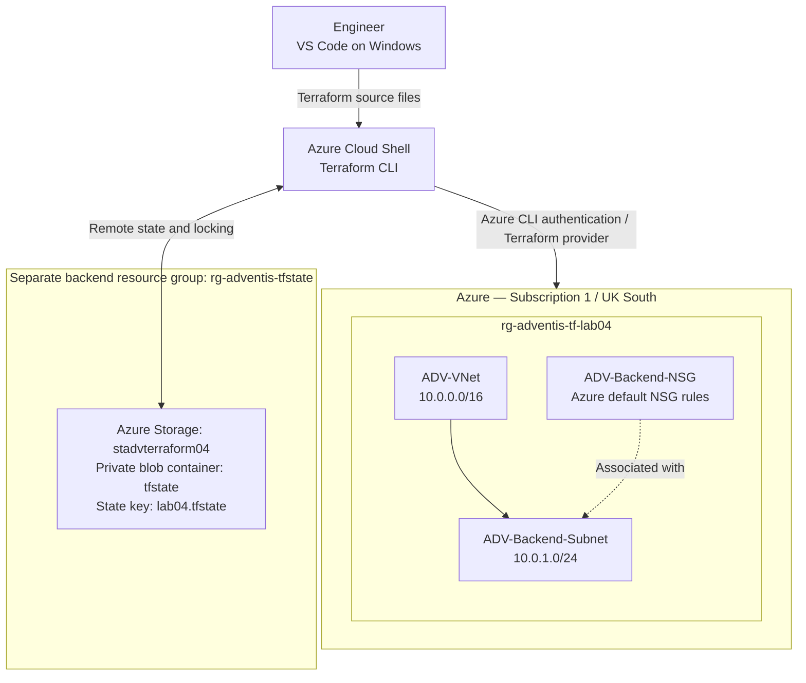

**Diagram note:** The NSG is associated with the subnet; it is not a separate network hop or appliance. The backend storage account is outside the disposable lab resource group.

### Deployed resources

| Terraform resource address | Azure resource / purpose |
|---|---|
| `azurerm_resource_group.lab04` | `rg-adventis-tf-lab04` — resource group in UK South |
| `azurerm_virtual_network.main` | `ADV-VNet` — `10.0.0.0/16` |
| `azurerm_subnet.backend` | `ADV-Backend-Subnet` — `10.0.1.0/24` |
| `azurerm_network_security_group.backend` | `ADV-Backend-NSG` — NSG with no custom security rules |
| `azurerm_subnet_network_security_group_association.backend` | Attaches the NSG to the backend subnet |

## 4. Tools and working environment

- **VS Code on Windows:** Authoritative local project files and editing.
- **Azure Cloud Shell (Bash):** Terraform and Azure CLI execution; uploaded source files were copied into the Cloud Shell project directory.
- **Terraform:** Version `1.17.0` observed during the lab; configuration required Terraform `>= 1.5.0` and AzureRM provider `~> 4.0`.
- **Azure Portal / Azure CLI:** Deployment inspection and verification.
- **GitHub Copilot Squad:** Read-only specialist reviews. No cloud access, code modification, or deployment was delegated to Squad.

Cloud Shell files and environment variables may not persist across sessions. The **remote Terraform state** is stored in Azure Blob Storage and is separate from the temporary Cloud Shell filesystem.

## 5. Repository structure

```text
adventis-terraform-lab04/
├── screenshots/
│   ├── 01-remote-state-storage.png
│   ├── 02-terraform-init.png
│   ├── 04-initial-apply.png
│   ├── 05-azure-resources.png
│   ├── 06-nsg-plan-and-apply.png
│   ├── 08-terraform-state-list.png
│   └── azure-subnet-nsg-association.png
├── .gitignore
├── .terraform.lock.hcl
├── backend.tf
├── main.tf
├── outputs.tf
├── providers.tf
├── variables.tf
├── versions.tf
└── README.md
```

| File | Responsibility |
|---|---|
| `versions.tf` | Terraform and provider version constraints |
| `backend.tf` | Azure Blob remote backend configuration |
| `providers.tf` | AzureRM provider configuration and subscription selection |
| `variables.tf` | Subscription, region, names, and network CIDR inputs |
| `main.tf` | Resource group, VNet, subnet, NSG, and subnet association |
| `outputs.tf` | Resource group name, VNet name, and subnet ID |
| `.terraform.lock.hcl` | Selected provider versions and checksums; commit to Git |
| `.gitignore` | Excludes local provider downloads, state files, variable secrets, and plan files |

### Selected configuration: NSG and association

The following was added in the second phase, after the initial network had been deployed:

```hcl
resource "azurerm_network_security_group" "backend" {
  name                = "ADV-Backend-NSG"
  location            = azurerm_resource_group.lab04.location
  resource_group_name = azurerm_resource_group.lab04.name
}

resource "azurerm_subnet_network_security_group_association" "backend" {
  subnet_id                 = azurerm_subnet.backend.id
  network_security_group_id = azurerm_network_security_group.backend.id
}
```

These references allow Terraform to infer the resource dependencies without an explicit `depends_on` block.

## 6. Remote Terraform state backend

The state backend was created separately from the disposable network resources:

| Setting | Lab configuration |
|---|---|
| Resource group | `rg-adventis-tfstate` |
| Storage account | `stadvterraform04` |
| Blob container | `tfstate` (private) |
| State blob key | `lab04.tfstate` |
| Storage redundancy | Standard LRS |
| Authentication | Microsoft Entra ID / Azure CLI |
| Data-plane role | Storage Blob Data Contributor, scoped to the state container |
| Additional protections | Blob versioning; seven-day soft delete; HTTPS; TLS 1.2 minimum; anonymous Blob access disabled; shared-key authentication disabled |
| Network access | Public storage endpoint enabled for this Cloud Shell-based lab |

`backend.tf` used:

```hcl
terraform {
  backend "azurerm" {
    resource_group_name  = "rg-adventis-tfstate"
    storage_account_name = "stadvterraform04"
    container_name       = "tfstate"
    key                  = "lab04.tfstate"
    use_azuread_auth     = true
    use_cli              = true
  }
}
```

**Remote state verification**

The Azure Portal confirms that `lab04.tfstate` is stored in the
private `tfstate` container.


**Security considerations:** Public endpoint access is not equivalent to anonymous access, but it remains a network exposure to assess for production. Standard LRS provides local redundancy, not zone redundancy. Production designs should consider private connectivity, recovery requirements, access governance, and state backup/retention policies.

**Do not commit** Terraform state files, saved plan files, credential files, or sensitive `.tfvars` values to GitHub.

## 7. Deployment workflow

### Subscription selection

The project defined a required `subscription_id` input. After confirming the active Azure subscription was the intended **Subscription 1**, Cloud Shell supplied the value with:

```bash

az account show --query "{Name:name,Id:id}" --output table

export TF_VAR_subscription_id="$(az account show --query id -o tsv)"
```
A fresh Cloud Shell session may require this variable to be set again. **Always verify the active subscription first**; this account had more than one available subscription.

**Prerequisite:** Before running `terraform init`, ensure the remote state storage account and private blob container described in Section 6 have been created and that the executing identity has the required storage permissions.


### Phase 1 — Initial networking foundation

The initial `main.tf` defined the resource group, VNet, and subnet. After uploading the Terraform files to Cloud Shell, the workflow was:

The initial plan was reviewed in the terminal before a saved execution plan was generated for the approved deployment.

```bash
cd ~/adventis-terraform-lab04
terraform init
terraform fmt -check
terraform validate
terraform plan
terraform plan -out=lab04.tfplan
terraform show -no-color lab04.tfplan
# After explicit review and approval:
terraform apply lab04.tfplan
```
**Terraform initialisation verification**

Terraform successfully initialised the working directory.

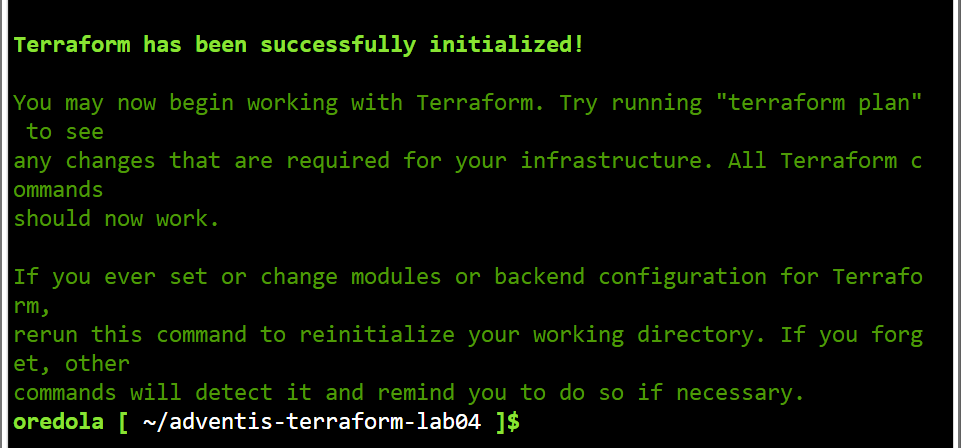

**Initial infrastructure deployment — successful apply**

Terraform successfully deployed the resource group, virtual network, and backend subnet, with 3 resources added, 0 changed, and 0 destroyed.

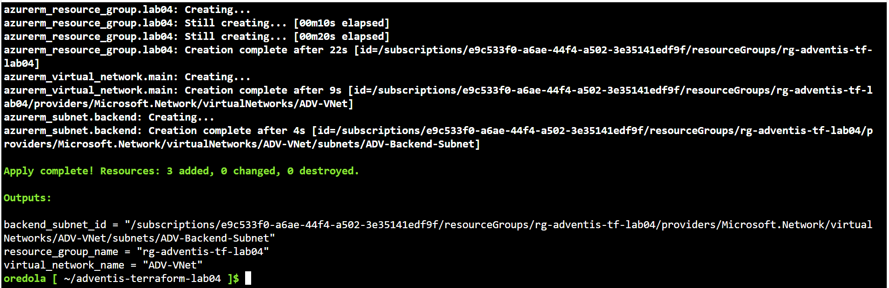

### Phase 2 — Incremental NSG deployment

The NSG and subnet association were appended to `main.tf` in the local VS Code project, reviewed by Squad, then transferred to Cloud Shell. The workflow was:

```bash
cd ~/adventis-terraform-lab04
terraform fmt -check
terraform validate
terraform plan
terraform plan -out=lab04-nsg.tfplan
terraform show -no-color lab04-nsg.tfplan
# After a separate explicit approval:
terraform apply lab04-nsg.tfplan
```

**Incremental NSG deployment — plan and successful apply**

Terraform successfully applied two additional Terraform-managed resources: the `ADV-Backend-NSG` Network Security Group and its association with the existing `ADV-Backend-Subnet`. The execution completed with `2 added, 0 changed, 0 destroyed`, preserving the original network infrastructure.

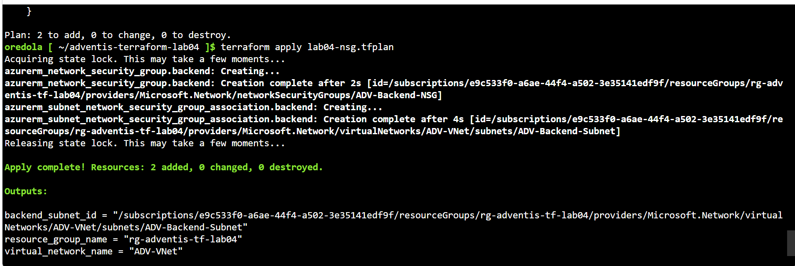


**Why save a plan?** `terraform plan -out=...` captures the reviewed execution plan for subsequent application. Plans can contain sensitive data and should not be committed.


## 8. Security decisions and limitations

### Why no custom NSG rules?

The subnet was empty: no VMs, applications, or databases were deployed, and there were no justified workload-specific ports or source networks. The team deliberately created an NSG with Azure's built-in rules, rather than inventing application access requirements.

Azure's built-in NSG defaults include:

| Direction | Default rule / priority | Effect |
|---|---|---|
| Inbound | AllowVnetInBound / 65000 | Allow traffic matching the VirtualNetwork service tag |
| Inbound | AllowAzureLoadBalancerInBound / 65001 | Allow Azure Load Balancer traffic |
| Inbound | DenyAllInBound / 65500 | Deny other unmatched inbound traffic |
| Outbound | AllowVnetOutBound / 65000 | Allow traffic matching the VirtualNetwork service tag |
| Outbound | AllowInternetOutBound / 65001 | Allow Internet-bound traffic |
| Outbound | DenyAllOutBound / 65500 | Deny other unmatched outbound traffic |

**Important:** An NSG with default rules does **not** fully isolate a subnet or enforce deny-all egress. Actual reachability also depends on network topology, routing, outbound connectivity, and other controls. The subnet plan showed `default_outbound_access_enabled = true`; future workloads would require a deliberate outbound access design.

### Production hardening opportunities

- Define required application traffic flows and least-privilege NSG rules before adding workloads.
- Evaluate explicit outbound controls and egress architecture instead of relying on default outbound access.
- Consider private connectivity to the Terraform state storage account.
- Review remote-state retention, redundancy, monitoring, and access policies.
- Add automated checks and deployment pipelines with explicit approval gates when appropriate.

These are **future improvements**, not controls implemented in this lab.

## 9. Verification and evidence

The following read-only Azure CLI commands were used after deployment:

```bash
az network nsg show \
  --resource-group rg-adventis-tf-lab04 \
  --name ADV-Backend-NSG \
  --query "{Name:name,Location:location,ProvisioningState:provisioningState}" \
  --output table

az network vnet subnet show \
  --resource-group rg-adventis-tf-lab04 \
  --vnet-name ADV-VNet \
  --name ADV-Backend-Subnet \
  --query "networkSecurityGroup.id" \
  --output tsv

terraform state list
```

### Terraform state verification

The `terraform state list` command confirmed that Terraform tracked five resource addresses following the incremental NSG deployment, including the NSG and its association with the existing subnet.

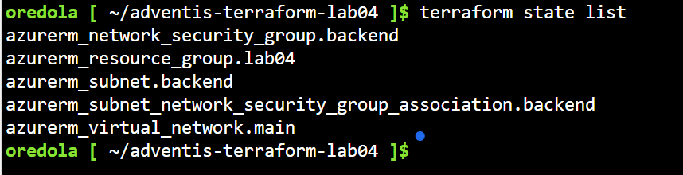


### Azure resource verification

The Azure Portal confirms that `ADV-VNet` and `ADV-Backend-NSG` were deployed in the `rg-adventis-tf-lab04` resource group.

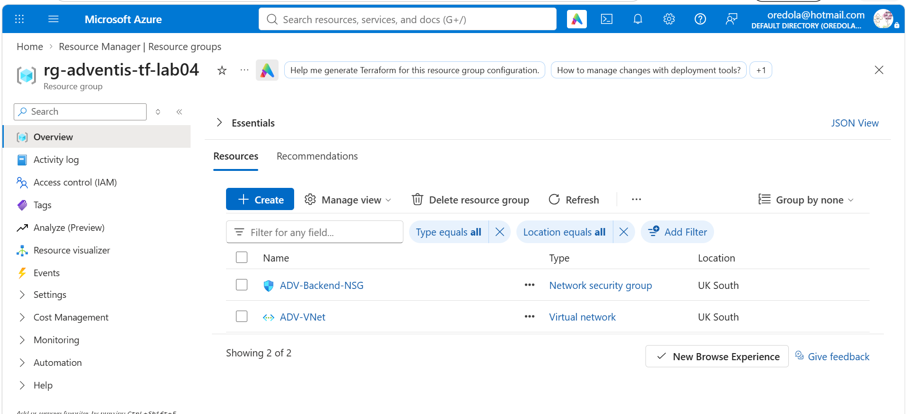

### Azure subnet and NSG verification

The Azure Portal confirms that `ADV-Backend-Subnet` (`10.0.1.0/24`) is associated with `ADV-Backend-NSG`.

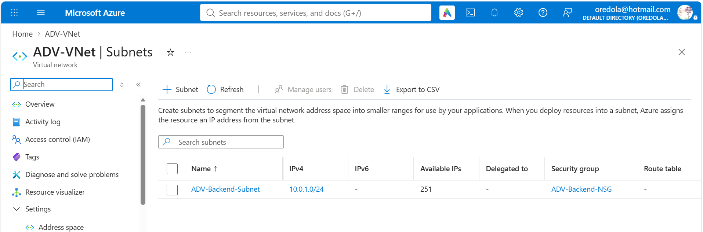


## 10. Troubleshooting and lessons learned

| Issue | Observation | Resolution / lesson |
|---|---|---|
| Wrong working directory | `terraform validate` reported a missing provider when run from `/home/oredola` | Changed to `~/adventis-terraform-lab04`; validation passed. Terraform commands use the current directory. |
| Missing subscription input | `terraform plan` prompted for `var.subscription_id` after a Cloud Shell session change | Verified the active subscription and restored `TF_VAR_subscription_id`. Session environment variables are not persistent. |
| Stale remote-state lock | A subsequent plan reported `state blob is already locked` after an interrupted plan | Checked for local Terraform processes and other active operations before explicitly using `terraform force-unlock` for the identified lock. **Never bypass state locking casually.** |
| Local/cloud file mismatch | VS Code contained the updated NSG code, but the original uploaded ZIP did not | Uploaded only the revised `main.tf` and copied it into the Cloud Shell project directory; verified its contents before validation. |
| Provider lock file transfer | `.terraform.lock.hcl` was difficult to locate after browser download | Downloaded a temporary renamed copy and restored the exact `.terraform.lock.hcl` filename in the local project. |

### Key engineering takeaways

1. **State is critical:** Terraform needs reliable, protected state to understand the infrastructure it manages.
2. **Plan before apply:** Validation checks configuration structure; the plan reveals intended Azure changes.
3. **Treat locks carefully:** A lock is a safeguard, not an obstacle to bypass without investigation.
4. **Review incremental changes:** The second plan proposed only the NSG and association, demonstrating that Terraform can evolve existing infrastructure.
5. **Security must follow requirements:** An empty subnet did not justify invented application ports, but Azure's default NSG rules are not equivalent to strict isolation.
6. **Keep source consistent:** The local VS Code project is the source of truth for Terraform configuration files; Azure Blob Storage holds the persistent remote Terraform state, while Cloud Shell serves as the execution environment for this lab.

## 11. Infrastructure Cleanup — Completed

**Cleanup date:** 19 November 2026  
**Status:** Completed and verified  
**Environment:** Microsoft Azure — UK South

### 11.1 Cleanup objective

Following successful deployment, security configuration, and verification, the Adventis Global Lab 04 infrastructure was decommissioned using Terraform.

The objective was to remove the five Terraform-managed lab resources while retaining the separate remote-state backend.

### 11.2 Pre-destroy verification

Before cleanup, the Terraform state was inspected:

```bash
terraform state list
```

The state contained five resources:

```text
azurerm_network_security_group.backend
azurerm_resource_group.lab04
azurerm_subnet.backend
azurerm_subnet_network_security_group_association.backend
azurerm_virtual_network.main
```

### 11.3 Destroy plan and review

A saved destroy plan was generated:

```bash
terraform plan -destroy -out=lab04-destroy.tfplan
```

Terraform refreshed the existing infrastructure state and produced the following summary:

```text
Plan: 0 to add, 0 to change, 5 to destroy.
```

The plan was reviewed before execution to confirm that the five Lab 04 resources were targeted.

The remote-state backend was not included in the destroy plan.

**Evidence — Destroy plan**

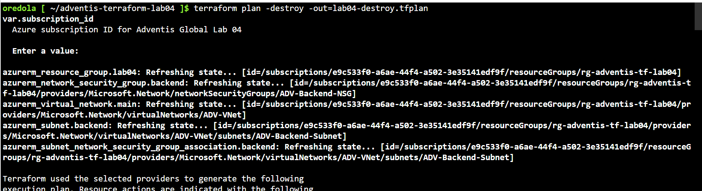

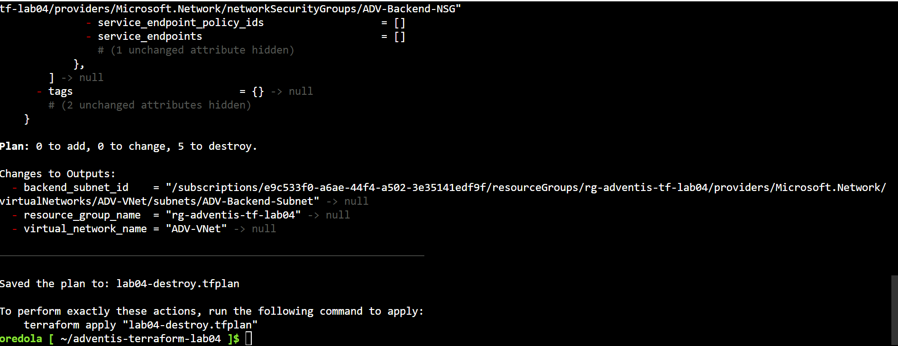

### 11.4 Destroy execution

Following review, the saved plan was applied:

```bash
terraform apply "lab04-destroy.tfplan"
```

Terraform reported:

```text
Apply complete! Resources: 0 added, 0 changed, 5 destroyed.
```

**Evidence — Successful destruction**

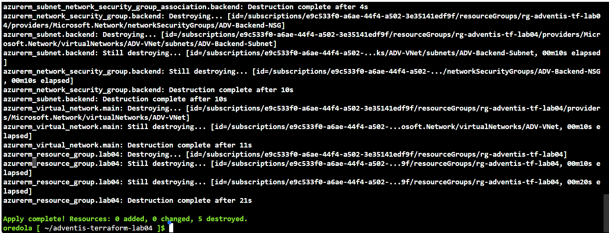

### 11.5 Post-destroy verification

Two checks were performed to verify cleanup.

**Terraform state verification**

```bash
terraform state list
```

The command returned no resource addresses, confirming that Terraform no longer tracked any Lab 04 infrastructure resources.

**Azure resource group verification**

```bash
az group exists --name rg-adventis-tf-lab04
```

Result:

```text
false
```

This independently confirmed that the Lab 04 resource group no longer existed in Azure.

**Evidence — Final cleanup verification**

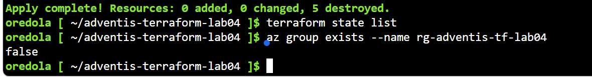

### 11.6 Remote-state backend retention

The following resources were intentionally excluded from the Lab 04 Terraform destroy operation:

| Resource | Name | Cleanup decision |
|---|---|---|
| Remote-state resource group | `rg-adventis-tfstate` | Retained |
| Azure Storage account | `stadvterraform04` | Retained |
| Blob container | `tfstate` | Retained |
| Terraform state blob | `lab04.tfstate` | Not targeted for deletion |

The remote-state backend is managed separately from the Lab 04 infrastructure. Any future deletion requires a separate review and approval.

### 11.7 Cleanup outcome

**Lab 04 infrastructure cleanup was completed successfully on 19 November 2026.**

The exercise demonstrated the complete Terraform infrastructure lifecycle: provisioning, configuration, validation, state management, controlled destruction, and post-destroy verification.

The Terraform configuration and supporting evidence remain available in this repository for documentation and reproducibility.

## 12. Further development

Possible next steps include workload-specific NSG rules, a deliberately designed egress path, infrastructure modules, automated policy checks, CI/CD workflows, and an application tier that exercises the network security design.

---

**Portfolio note:** This lab demonstrates foundational Azure networking and Terraform operations, including state security, change review, incremental deployment, and operational troubleshooting. It is not presented as a production-ready application platform.
